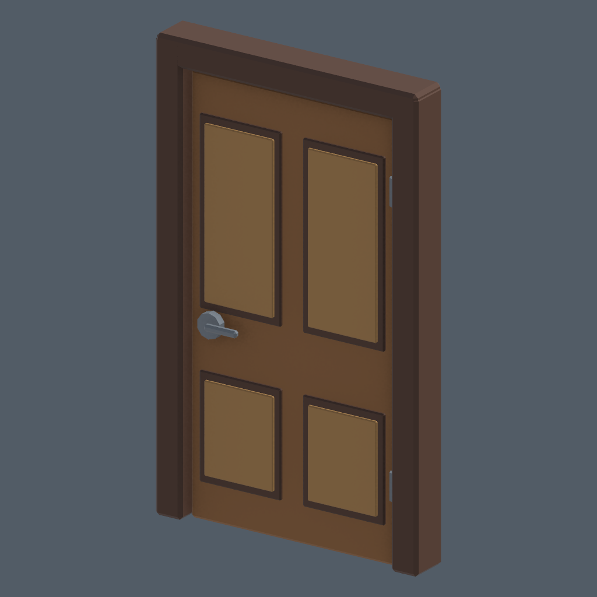
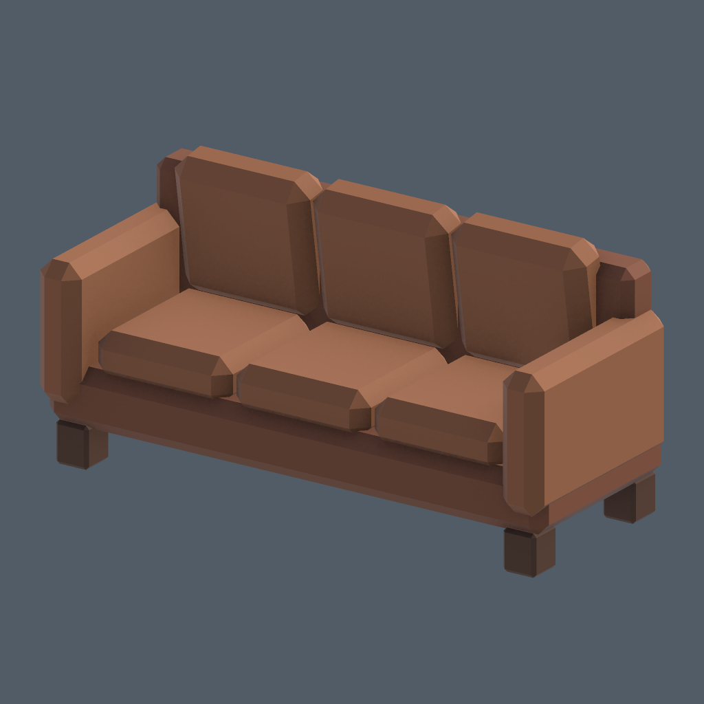

# Model Production

Updated: 2026-11-16. Status: models imported and visually verified in Unity.

Eleven colored low-poly model subjects plus a pre-cut door variant. Blender sources and [colored concept sheets](../ModelingSketches.md) are maintained by subject. One Blender unit equals one meter. All characters are static meshes without skeletons; the resident is in a T-pose.

## Assets

| Asset | Triangles | Blender source | Unity prefab |
| --- | ---: | --- | --- |
| CoffeeTable | 396 | [Source](../Props/CoffeeTable/source.blend) | [Prefab](../../../Assets/Prefabs/Props/CoffeeTable.prefab) |
| Sledgehammer | 296 | [Source](../Props/Sledgehammer/source.blend) | [Prefab](../../../Assets/Prefabs/Props/Sledgehammer.prefab) |
| Hose | 420 | [Source](../Props/Hose/source.blend) | [Prefab](../../../Assets/Prefabs/Props/Hose.prefab) |
| Door | 1,096 | [Source](../Props/Door/source.blend) | [Prefab](../../../Assets/Prefabs/Props/Door.prefab) |
| Trampoline | 844 | [Source](../Props/Trampoline/source.blend) | [Prefab](../../../Assets/Prefabs/Props/Trampoline.prefab) |
| Cat | 2,362 | [Source](../Characters/Cat/source.blend) | [Prefab](../../../Assets/Prefabs/Characters/Cat.prefab) |
| RescueDrone | 2,000 | [Source](../Vehicles/RescueDrone/source.blend) | [Prefab](../../../Assets/Prefabs/RescueDrone.prefab) |
| BaseHouse | 20,532 | [Source](../Environments/BaseHouse/source.blend) | [Prefab](../../../Assets/Prefabs/BaseHouse.prefab) |
| Resident | 2,248 | [Source](../Characters/Resident/source.blend) | [Prefab](../../../Assets/Prefabs/Characters/Resident.prefab) |
| Sofa | 616 | [Source](../Props/Sofa/source.blend) | [Prefab](../../../Assets/Prefabs/Props/Sofa.prefab) |
| Armchair | 440 | [Source](../Props/Armchair/source.blend) | [Prefab](../../../Assets/Prefabs/Props/Armchair.prefab) |
| DoorFractured | 3,860 | [Source](../Props/Door/fractured.blend) | [Prefab](../../../Assets/Prefabs/Props/DoorFractured.prefab) |

## Modular house

The base house uses 16 module types and 351 connected module instances, grouped by floor and purpose. Its structure is 12 × 10 m, with floor surfaces at 0.2, 3.2 and 6.2 m, and the roof at 9.2 m. Rear return stairs use 1.4 m-wide flights, 0.1875 m risers and intermediate landings. Each floor has a corridor and two-room apartment. The roof has no damage hole; the stair opening is enclosed by the rooftop access room.

The Unity prefab adds a sofa, armchair, coffee table and apartment doors per floor. Blender architectural sources contain the structural kit; furniture remains available as separate source assets. Disable upper floor groups and Roof/RoofAccess to inspect interiors.

Each floor has `Floor_N/BreakableSlots/BreakableSlot_*`. Its replaceable child is the `BreakableWallPlaceholder` prefab: width 2 m, height 2.8 m, thickness 0.12 m, bottom-center pivot. Unity-local axes are X width, Y height and Z thickness. Remove or disable that child and place generated wall content at the slot transform. Fixed walls do not cover these slots. No wall-generation or destruction runtime system is added.

## Drone and door

The drone uses eight source module types: hull, arm, guard, rotor, pylon, platform, restraint and skid. Its 21 instances remain connected to reusable prefabs. Four rotors have independent local pivots; PilotAnchor is retained. Carrying clearance requires gameplay validation.

Door and DoorFractured share their assembly origin and dimensions. The intact leaf pivots at its hinge; the fractured variant has 20 independent mesh fragments with local pivots and a separate frame. The fragments total 3,672 triangles; the frame brings the variant to 3,860. Swap matching roots to transition between assets. Primitive colliders are authored on the intact leaf, frame and each fractured piece. Rigidbodies, impact triggering, fragment lifetime and damage states remain gameplay integration work.

The hose asset is a nozzle plus a short section, without flexible hose simulation. Colors use shared `FS_*` URP Lit materials under `Assets/Materials/Models`; no baked texture maps.

## Collision geometry

Updated 2026-11-16: collision is authored in reusable prefab assets and inherited by Main and ArtReview. Walls, wall sections, slabs, landings and props use Box Colliders; characters and rounded parts use Capsule/Sphere Colliders. Door and window wall modules preserve their openings. Existing window-frame and interior-wall colliders are retained. Decorative quoins, cornices, drone rotors and restraints have no additional colliders.

Updated 2026-11-17: the [editable breakable window](../Environments/BaseHouse/window.blend) replaces the original HouseWindow module export in place. The concrete surround retains its original geometry. The top and bottom panes use the existing transparent material, with three fragments per pane. Seven wooden fragments replace the solid backing. Unity uses intact meshes until impact and keeps the detached pieces render-only.

Each `Stairs/StairFlight` has one `WalkableRamp` child with a 32-degree Box Collider connecting the landing heights. The visible steps remain unchanged; the collision surface approximates their profile for smooth traversal. Do not add overlapping per-step colliders. Each sloped stair railing has six Box Colliders fitted to the handrail and five posts. Existing capsules on the landing railings remain connected prefab instances.

A temporary CharacterController probe (height 1.86 m, radius 0.34 m, slope limit 45 degrees, step offset 0.2 m, skin width 0.03 m) climbed all six flights in the assembled BaseHouse. The isolated flight also passed ascent/descent across both landing joins. These are Editor physics checks, not validation of a finished player controller. See the [collision validation report](../../Engineering/Reports/2026-11-16-prefab-collision.md).

## Verification

- [Blender validation](blender-validation.json): twelve source variants, finite vertices, no degenerate polygons, zero bones.
- [FBX round-trip](fbx-validation.json): all eleven primary exports match source dimensions and material slots.
- [Unity imports](unity-import.json): 36 FBX assets, no missing or non-URP material assignments, no character Animator components.
- [Assembly checks](unity-assembly.json): nested modular assemblies match combined FBX bounds within 0.01 m.
- [Saved-prefab checks](unity-prefab-validation.json): shared materials and connected nested roots.
- [Reopened scene check](unity-scene-validation.json): twelve connected prefab instances, no duplicate asset roots.
- [ArtReview scene](../../../Assets/Scenes/ArtReview.unity) contains connected prefab instances, visible in Edit Mode. It is an asset review scene, not a playable level and is not added to build settings.
- Unity CLI Pipeline remained unavailable after authentication/refresh. A temporary Editor command used Unity APIs for authoring and was removed after verification. The failed temporary Pipeline dependency was removed. The Package Manager online-search error remains a separate authentication issue; model import and rendering succeeded. No restart or player build was performed.

## Unity previews

### CoffeeTable

### Sledgehammer

### Hose

### Door

### Trampoline

### Cat

### RescueDrone

### BaseHouse

### Resident

### Sofa

### Armchair

### House interior

### Door pre-cut assembly

[Exploded fragment view](../Props/Door/fractured-exploded-preview.png) shows the individual pieces; assembled geometry intentionally looks intact.
