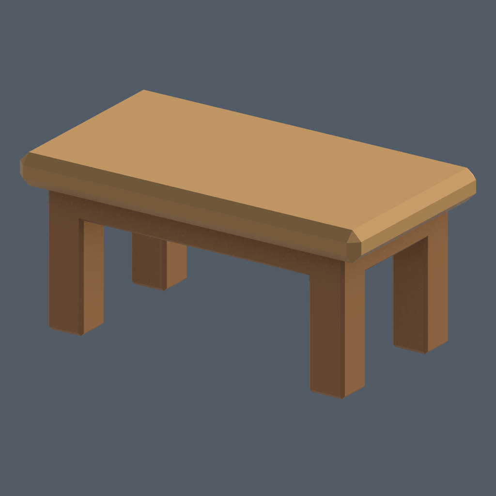
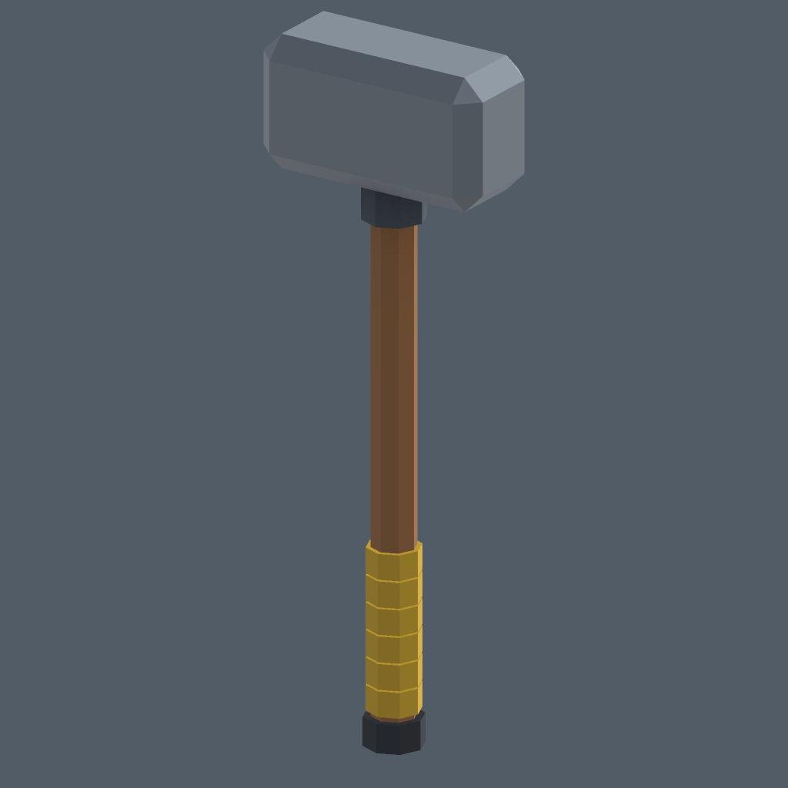
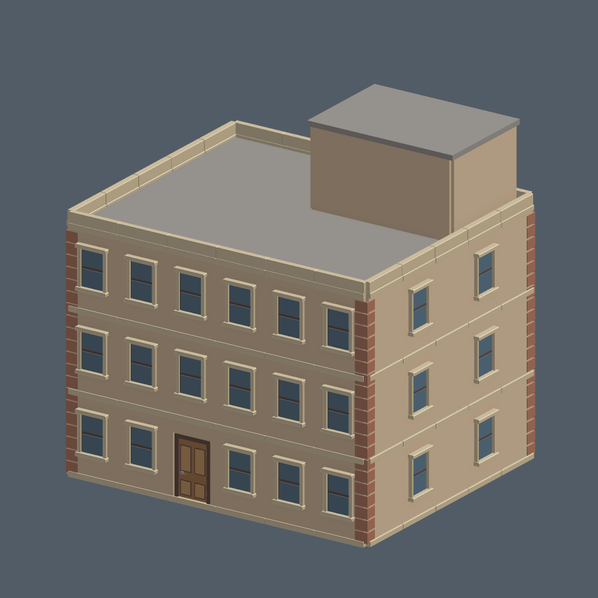
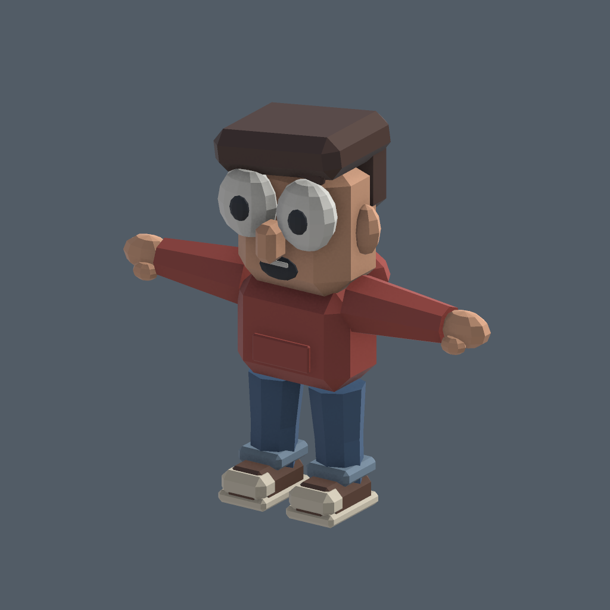
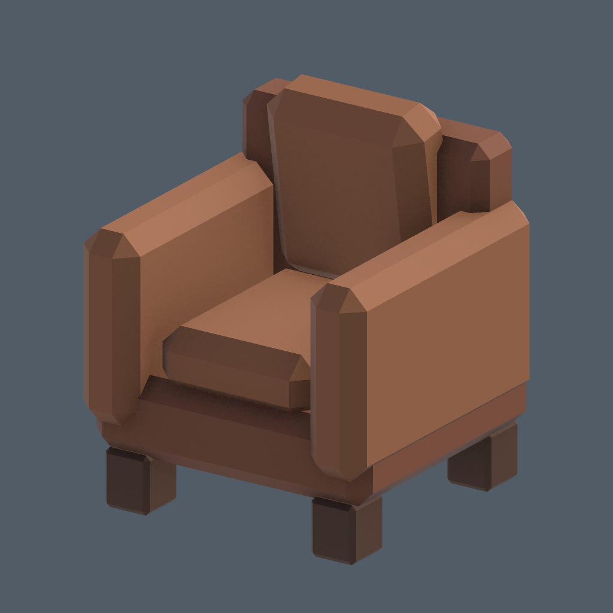
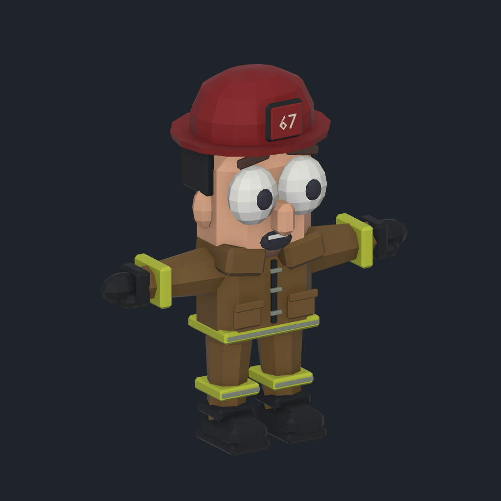
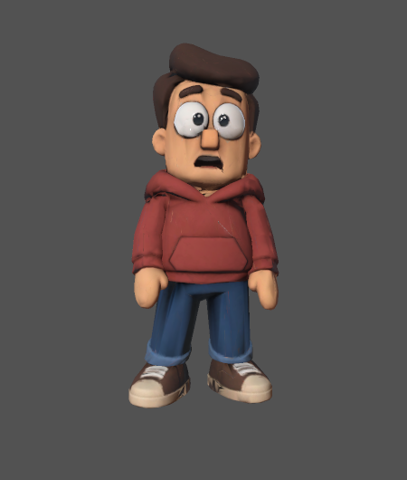
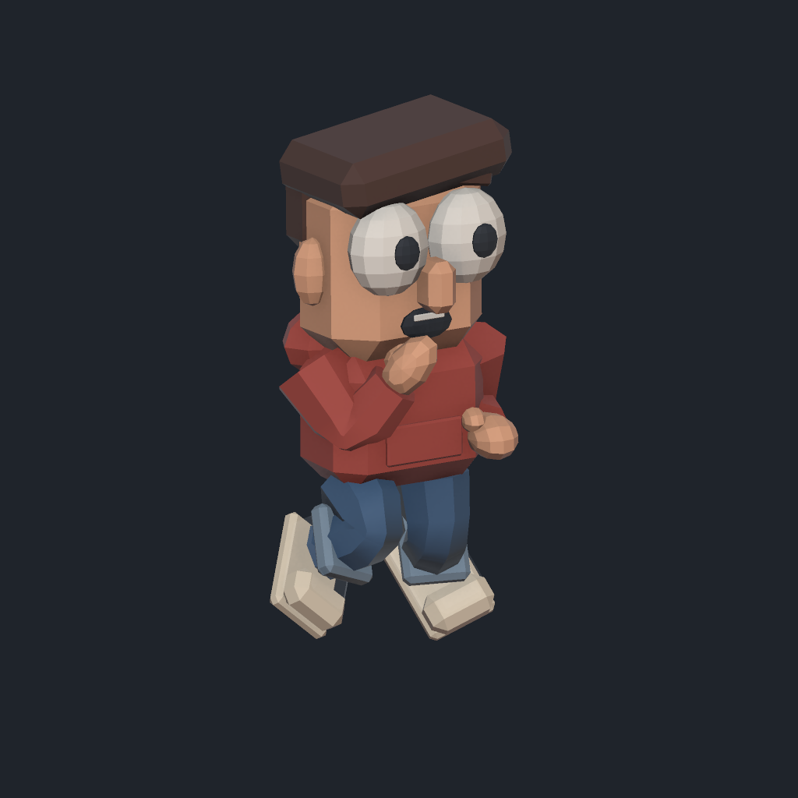
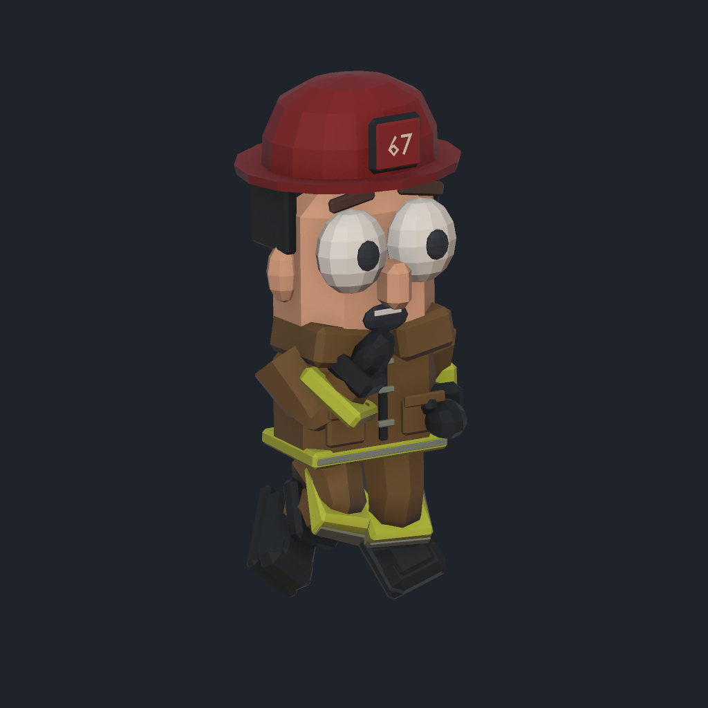

# Model Production

Updated: 2026-11-16. Status: models imported and visually verified in Unity.

Eleven colored low-poly model subjects plus a pre-cut door variant. Blender sources and [colored concept sheets](../ModelingSketches.md) are maintained by subject. One Blender unit equals one meter. Resident and Firefighter use skinned Humanoid rigs in a T-pose. Cat remains a static mesh.

## Assets

| Asset | Triangles | Blender source | Unity prefab |
| --- | ---: | --- | --- |
| CoffeeTable | 396 | [Source](../Props/CoffeeTable/source.blend) | [Prefab](../../../Assets/Prefabs/Props/Furniture/CoffeeTable.prefab) |
| Sledgehammer | 296 | [Source](../Props/Sledgehammer/source.blend) | [Prefab](../../../Assets/Prefabs/Props/Tools/Sledgehammer.prefab) |
| Hose | 420 | [Source](../Props/Hose/source.blend) | [Prefab](../../../Assets/Prefabs/Props/Tools/Hose.prefab) |
| Door | 1,096 | [Source](../Props/Door/source.blend) | [Prefab](../../../Assets/Prefabs/Props/Doors/Door.prefab) |
| Trampoline | 844 | [Source](../Props/Trampoline/source.blend) | [Prefab](../../../Assets/Prefabs/Props/Rescue/Trampoline.prefab) |
| Cat | 2,362 | [Source](../Characters/Cat/source.blend) | [Prefab](../../../Assets/Prefabs/Characters/Cat.prefab) |
| RescueDrone | 2,000 | [Source](../Vehicles/RescueDrone/source.blend) | [Prefab](../../../Assets/Prefabs/Modules/Drone/RescueDrone.prefab) |
| BaseHouse | 20,532 | [Source](../Environments/BaseHouse/source.blend) | [Prefab](../../../Assets/Prefabs/BaseHouse.prefab) |
| Resident | 2,540 | [Source](../Characters/Resident/source.blend) | [Prefab](../../../Assets/Prefabs/Characters/Resident/Resident.prefab) |
| Firefighter | 3,616 | [Source](../Characters/Firefighter/source.blend) | [Visual prefab](../../../Assets/Prefabs/Characters/Firefighter/FirefighterVisual.prefab) |
| Sofa | 616 | [Source](../Props/Sofa/source.blend) | [Prefab](../../../Assets/Prefabs/Props/Furniture/Sofa.prefab) |
| Armchair | 440 | [Source](../Props/Armchair/source.blend) | [Prefab](../../../Assets/Prefabs/Props/Furniture/Armchair.prefab) |
| DoorFractured | 3,860 | [Source](../Props/Door/fractured.blend) | [Prefab](../../../Assets/Prefabs/Props/Doors/DoorFractured.prefab) |

## Modular house

The base house uses 16 module types and 351 connected module instances, grouped by floor and purpose. Its structure is 12 × 10 m, with floor surfaces at 0.2, 3.2 and 6.2 m, and the roof at 9.2 m. Rear return stairs use 1.4 m-wide flights, 0.1875 m risers and intermediate landings. Each floor has a corridor and two-room apartment. The roof has no damage hole; the stair opening is enclosed by the rooftop access room.

The Unity prefab adds a sofa, armchair, coffee table and apartment doors per floor. Blender architectural sources contain the structural kit; furniture remains available as separate source assets. Disable upper floor groups and Roof/RoofAccess to inspect interiors.

Each floor has `Floor_N/BreakableSlots/BreakableSlot_*`. Its replaceable child is the `BreakableWallPlaceholder` prefab: width 2 m, height 2.8 m, thickness 0.12 m, bottom-center pivot. Unity-local axes are X width, Y height and Z thickness. Remove or disable that child and place generated wall content at the slot transform. Fixed walls do not cover these slots. No wall-generation or destruction runtime system is added.

## Drone and door

The drone uses eight source module types: hull, arm, guard, rotor, pylon, platform, restraint and skid. Its 21 instances remain connected to reusable prefabs. Four rotors have independent local pivots; PilotAnchor is retained. Carrying clearance requires gameplay validation.

Door and DoorFractured share their assembly origin and dimensions. The intact leaf pivots at its hinge; the fractured variant has 20 independent mesh fragments with local pivots and a separate frame. The fragments total 3,672 triangles; the frame brings the variant to 3,860. Swap matching roots to transition between assets. Primitive colliders are authored on the intact leaf, frame and each fractured piece. Rigidbodies, impact triggering, fragment lifetime and damage states remain gameplay integration work.

The hose asset is a nozzle plus a short section, without flexible hose simulation. Colors use shared `FS_*` URP Lit materials under `Assets/Materials/Models`; no baked texture maps.

## Collision geometry

Updated 2026-11-16: collision is authored in reusable prefab assets and inherited by Main and ArtReview. Walls, wall sections, slabs, landings and props use Box Colliders; characters and rounded parts use Capsule/Sphere Colliders. Door and window wall modules preserve their openings. Existing window-frame and interior-wall colliders are retained. Decorative quoins, cornices, drone rotors and restraints have no additional colliders.

Updated 2026-11-17: the [editable breakable window](../Environments/BaseHouse/window.blend) replaces the original HouseWindow module export in place. The concrete surround retains its original geometry. The top and bottom panes use the existing transparent material, with three fragments per pane. Seven wooden fragments replace the solid backing. Unity uses intact meshes until impact and keeps the detached pieces render-only.

Each `Stairs/StairFlight` has one `WalkableRamp` child with a 32-degree Box Collider connecting the landing heights. The visible steps remain unchanged; the collision surface approximates their profile for smooth traversal. Do not add overlapping per-step colliders. Each sloped stair railing has six Box Colliders fitted to the handrail and five posts. Existing capsules on the landing railings remain connected prefab instances.

A temporary CharacterController probe (height 1.86 m, radius 0.34 m, slope limit 45 degrees, step offset 0.2 m, skin width 0.03 m) climbed all six flights in the assembled BaseHouse. The isolated flight also passed ascent/descent across both landing joins. These are Editor physics checks, not validation of a finished player controller. See the [collision validation report](../../Engineering/Reports/2026-11-16-prefab-collision.md).

## Verification

- [Original Blender validation](blender-validation.json): pre-rig model-production snapshot. Current Resident and Firefighter checks are linked under Humanoid rigs below.
- [Original FBX round-trip](fbx-validation.json): pre-rig exports matched source dimensions and material slots. Current character exports are checked separately below.
- [Original Unity imports](unity-import.json): pre-rig import snapshot. Resident and Firefighter now have Animator components and Humanoid Avatars.
- [Assembly checks](unity-assembly.json): nested modular assemblies match combined FBX bounds within 0.01 m.
- [Saved-prefab checks](unity-prefab-validation.json): shared materials and connected nested roots.
- [Reopened scene check](unity-scene-validation.json): twelve connected prefab instances, no duplicate asset roots.
- [ArtReview scene](../../../Assets/Scenes/ArtReview.unity) contains connected prefab instances, visible in Edit Mode. It is an asset review scene, not a playable level and is not added to build settings.
- Unity CLI Pipeline remained unavailable after authentication/refresh. A temporary Editor command used Unity APIs for authoring and was removed after verification. The failed temporary Pipeline dependency was removed. The Package Manager online-search error remains a separate authentication issue; model import and rendering succeeded. No restart or player build was performed.

## Unity previews

### CoffeeTable

### Sledgehammer

### Hose

### Door

### Trampoline

### Cat

### RescueDrone

### BaseHouse

### Resident

### Sofa

### Armchair

### House interior

### Door pre-cut assembly

[Exploded fragment view](../Props/Door/fractured-exploded-preview.png) shows the individual pieces; assembled geometry intentionally looks intact.

## Firefighter

Updated 2026-11-17: the firefighter is derived from the resident Blender mesh and the red-helmet firefighters in the [Consepts Canvas reference](../../../FireSlop/FireSlop/Screens/Pasted%20image%2020261113145349.png). The original face, proportions and T-pose are retained. Added a red helmet with shield 67, neck protection, tan turnout clothing, reflective bands, dark gloves and boots. The editable source keeps equipment as separate meshes. The FBX now includes a 21-bone Humanoid skeleton and skin weights; animation clips are not included.

The existing gameplay Firefighter prefab now contains the connected FirefighterVisual prefab. Its first-person `ShadowsOnly` rendering, camera, controller and tools are preserved. Use FirefighterVisual for visible asset inspection. [Unity validation](../Characters/Firefighter/unity-validation.json) checks materials, prefab connectivity and component retention.

## Humanoid rigs

Updated 2026-11-17. Resident and Firefighter share a 21-bone layout with Hips, Spine, Chest, Neck, Head, shoulders, upper/lower arms, hands, upper/lower legs, feet and toes. All vertices have normalized weights with at most two influences. Additional elbow, knee and torso loops support deformation. Helmets and facial parts follow Head rigidly. The mitten-style hands have no individual finger rig or facial animation rig.

The maintained Blender sources and existing FBX GUIDs are preserved. Unity imports both as **Humanoid / Create From This Model**, with all 21 bones explicitly mapped and valid human Avatars. The model roots have unit scale and identity rotation. The existing prefab hierarchy contains one Animator per visible character model, with Apply Root Motion disabled. No animation controller or downloaded clips were added.

Resident's existing scene visual tilt and standing-restoration rotation were adapted to the normalized model axes. Its `ResidentCarryRig` mesh and `ResidentCarryRagdoll` prefab are unchanged: the separate physical carry representation remains independent of locomotion animation. The gameplay Firefighter keeps ShadowsOnly on its body; inspect FirefighterVisual when a visible full-body model is needed.

### Using Mixamo Idle and Run

1. Select Idle and Run on a Mixamo library character and download FBX animations. Use **Without Skin** for animation-only downloads and **In Place** for Run when available, because the current game controller owns movement.
2. Import each animation FBX into Unity as **Humanoid / Create From This Model** and check its bone mapping. Use the source animation's own Avatar; do not copy ResidentAvatar or FirefighterAvatar onto a different Mixamo skeleton.
3. Enable **Loop Time** for looping clips and assign them to an Animator Controller on the model's Animator. Keep the target model's own Avatar assigned and Apply Root Motion disabled. Movement-driven Idle/Run transitions remain a separate implementation step.
4. Preview each chosen animation on both characters and adjust hand/foot contacts for these short, large-headed proportions if needed.

Unity supports sharing clips between configured Humanoid Avatars: [Unity retargeting documentation](https://docs.unity3d.com/6000.0/Documentation/Manual/Retargeting.html). Uploading these models to Mixamo is not required for this workflow. [Adobe's rigged-character workflow](https://helpx.adobe.com/creative-cloud/help/mixamo-rigging-animation.html) is an alternative; upload compatibility has not been tested here.

### Current verification

- [Resident source](../Characters/Resident/humanoid-source-validation.json) and [FBX round-trip](../Characters/Resident/fbx-validation.json).
- [Firefighter source](../Characters/Firefighter/humanoid-source-validation.json) and [FBX round-trip](../Characters/Firefighter/fbx-validation.json).
- [Resident Animator playback](../Characters/Resident/humanoid-unity-validation.json) and [Firefighter Animator playback](../Characters/Firefighter/humanoid-unity-validation.json): the same temporary Humanoid muscle clip evaluated at 31 samples on each Avatar, with moving hands/feet, changing skinned vertices, finite output and stable roots. Foot IK was disabled for this isolated probe. No Mixamo animation was used in this check.
- [Saved prefabs and Main scene](humanoid-prefab-validation.json): valid assigned Avatars, preserved references, one resident, separate unchanged carry rig and retained first-person shadow rendering.

The following are baked Unity Humanoid test-pose snapshots, not downloaded Idle/Run animations:

