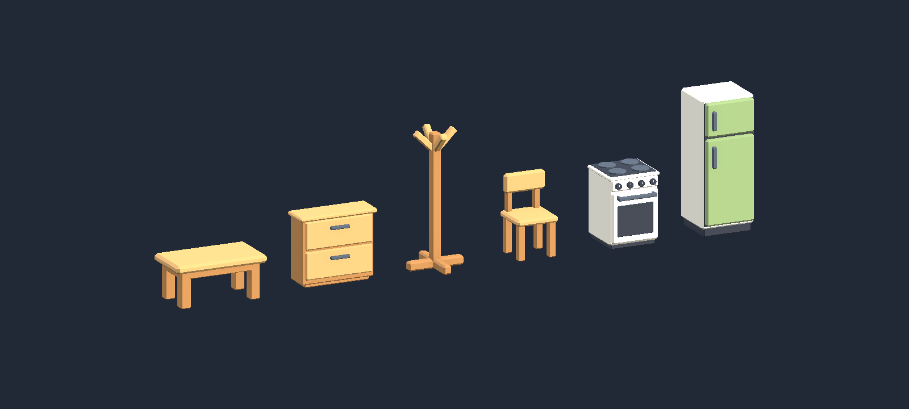
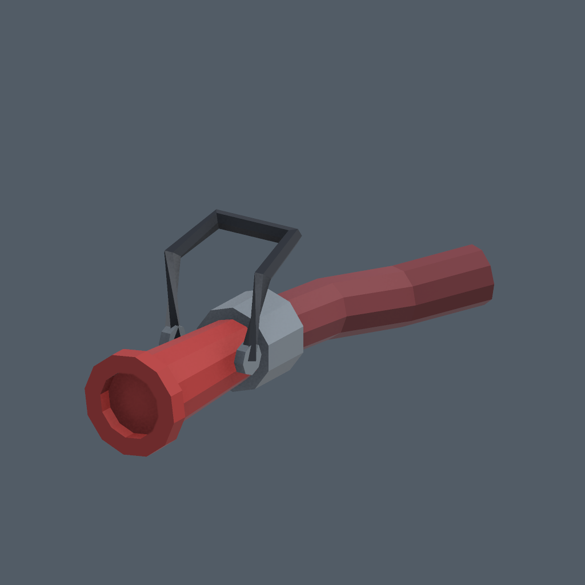
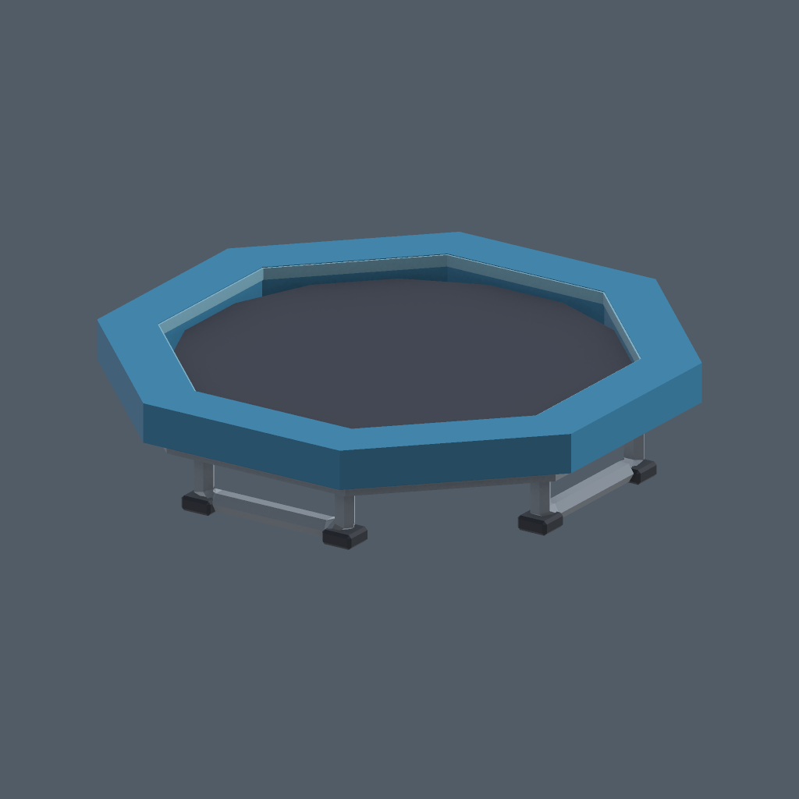
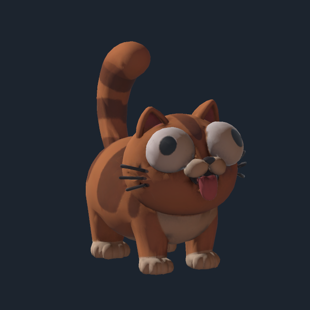
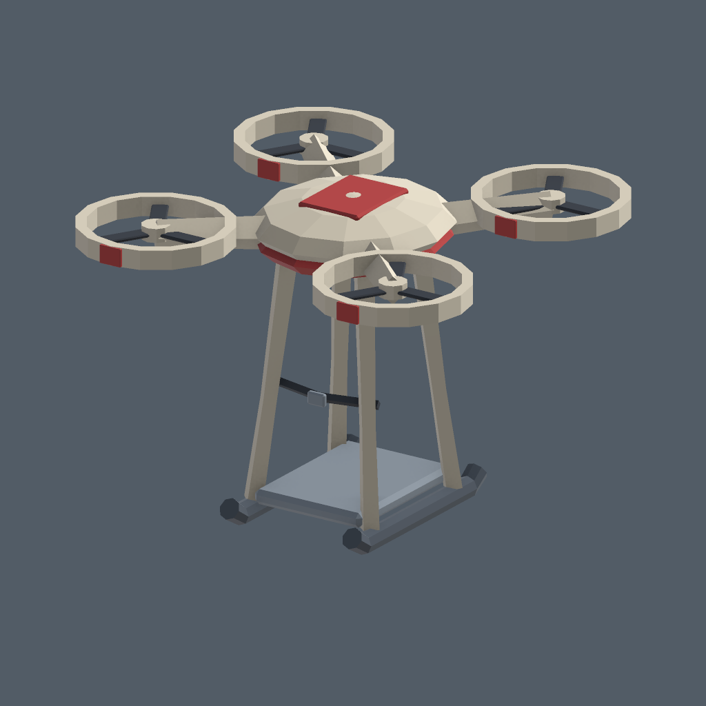
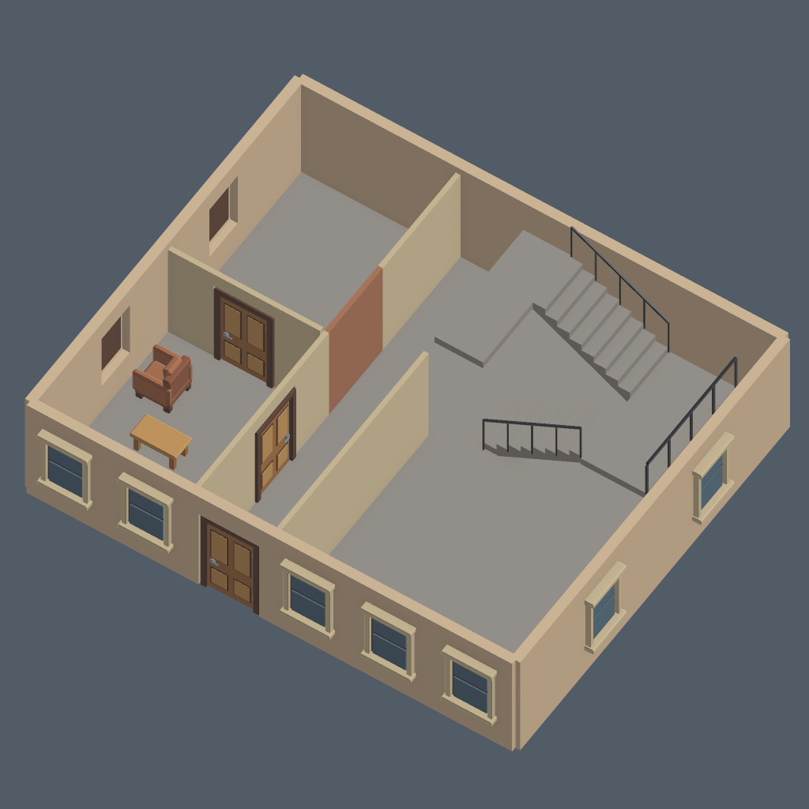

# Model Production

Updated: 2026-11-24. Status: models imported; see subject-specific verification below.

Colored low-poly models, including five expansion furniture assets and a pre-cut door variant. Blender sources and [colored concept sheets](../ModelingSketches.md) are maintained by subject. One Blender unit equals one meter. Resident and Firefighter use skinned Humanoid rigs in a T-pose. Cat uses a 14-bone Generic rig with five clips.

## Assets

| Asset | Triangles | Blender source | Unity prefab |
| --- | ---: | --- | --- |
| CoffeeTable | 396 | [Source](../Props/CoffeeTable/source.blend) | [Prefab](../../../Assets/Prefabs/Props/Furniture/CoffeeTable.prefab) |
| Fridge | 660 | [Source](../Props/Fridge/source.blend) | [Prefab](../../../Assets/Prefabs/Props/Furniture/Fridge.prefab) |
| Stove | 1,532 | [Source](../Props/Stove/source.blend) | [Prefab](../../../Assets/Prefabs/Props/Furniture/Stove.prefab) |
| DiningChair | 352 | [Source](../Props/DiningChair/source.blend) | [Prefab](../../../Assets/Prefabs/Props/Furniture/DiningChair.prefab) |
| CoatRack | 396 | [Source](../Props/CoatRack/source.blend) | [Prefab](../../../Assets/Prefabs/Props/Furniture/CoatRack.prefab) |
| ShoeCabinet | 528 | [Source](../Props/ShoeCabinet/source.blend) | [Prefab](../../../Assets/Prefabs/Props/Furniture/ShoeCabinet.prefab) |
| Sledgehammer | 296 | [Source](../Props/Sledgehammer/source.blend) | [Prefab](../../../Assets/Prefabs/Props/Tools/Sledgehammer.prefab) |
| Hose | 420 | [Source](../Props/Hose/source.blend) | [Prefab](../../../Assets/Prefabs/Props/Tools/Hose.prefab) |
| Door | 1,096 | [Source](../Props/Door/source.blend) | [Prefab](../../../Assets/Prefabs/Props/Doors/Door.prefab) |
| Trampoline | 844 | [Source](../Props/Trampoline/source.blend) | [Prefab](../../../Assets/Prefabs/Props/Rescue/Trampoline.prefab) |
| Cat | 4,896 | [Source](../Characters/Cat/ginger-cat.blend) | [Prefab](../../../Assets/Prefabs/Characters/Cat.prefab) |
| RescueDrone | 2,000 | [Source](../Vehicles/RescueDrone/source.blend) | [Prefab](../../../Assets/Prefabs/Modules/Drone/RescueDrone.prefab) |
| BaseHouse | 20,532 | [Source](../Environments/BaseHouse/source.blend) | [Prefab](../../../Assets/Prefabs/BaseHouse.prefab) |
| Resident | 2,540 | [Source](../Characters/Resident/source.blend) | [Prefab](../../../Assets/Prefabs/Characters/Resident/Resident.prefab) |
| Firefighter | 3,616 | [Source](../Characters/Firefighter/source.blend) | [Visual prefab](../../../Assets/Prefabs/Characters/Firefighter/FirefighterVisual.prefab) |
| Sofa | 616 | [Source](../Props/Sofa/source.blend) | [Prefab](../../../Assets/Prefabs/Props/Furniture/Sofa.prefab) |
| Armchair | 440 | [Source](../Props/Armchair/source.blend) | [Prefab](../../../Assets/Prefabs/Props/Furniture/Armchair.prefab) |
| DoorFractured | 3,860 | [Source](../Props/Door/fractured.blend) | [Prefab](../../../Assets/Prefabs/Props/Doors/DoorFractured.prefab) |

## Expansion furniture

Delivered 2026-11-24 from the [five concept sheets](../ModelingSketches.md#expansion-furniture-concepts). Sources retain named editable construction parts and a studio camera; each exported [FBX](../../../Assets/Models/Props/) retains a static carcass and independent hinged door meshes. Chair and coat rack each use one mesh. No new texture maps are needed. Existing `FS_HoneyWood`, `FS_Wood`, `FS_Ivory`, `FS_Charcoal` and `FS_DarkSteel` materials are reused; `FS_SageEnamel` is the fridge's new shared URP Lit material. Bevels use one segment. The coat rack uses four aligned hooks and four feet; the shoe cabinet's closed panels use consistent shallow bevels.

| Asset | Width × height × depth, meters | Box colliders | Initial mass, kg |
| --- | --- | ---: | ---: |
| Fridge | 0.660 × 1.650 × 0.713 | 13 | 55 |
| Stove | 0.640 × 0.905 × 0.700 | 10 | 40 |
| DiningChair | 0.520 × 0.955 × 0.500 | 8 | 6 |
| CoatRack | 0.700 × 1.658 × 0.700 | 9 | 5 |
| ShoeCabinet | 0.980 × 0.863 × 0.406 | 9 | 18 |

Sizes include handles and bevels. Chair seat height is 0.493 m at its top; the existing coffee table is 0.530 m high. All prefab roots have identity transforms, ground-center origins and Unity +Z facing. Named source parts and hinge pivots remain editable. Fridge compartments open independently; the oven door folds down and shoe panels tilt forward. Interiors have modeled shelves. Existing Openable, SwingOpenView and CabinetContextTarget components provide the shared Open/Close action. Nested leaf renderers retain authored identity-rotation overrides to compensate for FBX baked-axis child rotations. Unity uses the existing furniture import compression (Medium), imported normals, no animation and persistent external material remaps. Axis conversion is baked at import.

Each reusable wrapper contains a connected FBX instance, Rigidbody, `Movable`, stationary-carving NavMeshObstacle and `FurnitureNavigationView`. Physics assets live in `Assets/SO/Furniture/`; masses above are initial tuning values, with the existing 3/3 linear/angular damping. All five use fitted primitive collision. Hollow cabinets and appliances retain separate frame, shelf, base-support and moving-leaf colliders; chair and rack preserve the openings between their parts. Their water receiver is the existing `IWaterTarget` path, with no new runtime code. Main contains 21 new connected instances with unique `Movable._contentId` overrides. Asset-default IDs identify the type only. Mission Restart reloads the saved Main scene, restoring authored placement and fresh closed-panel state; no runtime furniture spawning or additional position registry is used.

The saved [FurnitureReview scene](../../../Assets/Scenes/FurnitureReview.unity) contains the five connected new prefabs and the existing coffee table at the same world scale. It is an Edit Mode asset review scene, excluded from build settings. Main now contains three East Kitchen groups and six entryway groups. Intro and HUD layouts are unchanged. See the [house integration report](../../Engineering/Reports/2026-11-24-furniture-placement.md) for placement and restart checks.

The Unity render was visually inspected for facades, part counts, palette, scale and unclipped silhouettes. Individual Blender previews: [fridge](../Props/Fridge/model-preview.png), [stove](../Props/Stove/model-preview.png), [chair](../Props/DiningChair/model-preview.png), [coat rack](../Props/CoatRack/model-preview.png), [shoe cabinet](../Props/ShoeCabinet/model-preview.png).

Verification: [source geometry](furniture-blender-validation.json), [closed source meshes and retained FBX geometry/hinges](furniture-fbx-validation.json), [saved Unity prefabs](furniture-unity-validation.json), [Play Mode water response and instance isolation](furniture-physics-validation.json). All five passed. Prefab links were checked again after reopening the review scene. See the [production report](../../Engineering/Reports/2026-11-24-furniture-models.md) for scope and limits.

### Furniture in the house

The three east rear rooms contain a fridge, stove and dining chair each. Each east corridor entry and west apartment entry has a coat rack and shoe cabinet. The existing east ground-floor sofa moved into its living room; the west second-floor sofa moved 0.2 m to preserve entryway clearance. These transforms are saved in Main, visible without Play Mode.

[Ground-floor layout](../Environments/BaseHouse/furniture-ground-floor.png) · [Open kitchen interiors](../Environments/BaseHouse/furniture-open-kitchen.png). These are Unity inspection renders with upper-floor renderers temporarily hidden and temporary inspection lighting/fog overrides; those overrides were restored and not saved.

## Modular house assembly

The base house uses 16 module types and 351 connected module instances, grouped by floor and purpose. Its structure is 12 × 10 m, with floor surfaces at 0.2, 3.2 and 6.2 m, and the roof at 9.2 m. Rear return stairs use 1.4 m-wide flights, 0.1875 m risers and intermediate landings. Each floor has a corridor and two-room apartment. The roof has no damage hole; the stair opening is enclosed by the rooftop access room.

The Unity prefab adds a sofa, armchair, coffee table and apartment doors per floor. Blender architectural sources contain the structural kit; furniture remains available as separate source assets. Disable upper floor groups and Roof/RoofAccess to inspect interiors.

Each floor has `Floor_N/BreakableSlots/BreakableSlot_*`. Its replaceable child is the `BreakableWallPlaceholder` prefab: width 2 m, height 2.8 m, thickness 0.12 m, bottom-center pivot. Unity-local axes are X width, Y height and Z thickness. Remove or disable that child and place generated wall content at the slot transform. Fixed walls do not cover these slots. No wall-generation or destruction runtime system is added.

## Drone and door

The drone uses eight source module types: hull, arm, guard, rotor, pylon, platform, restraint and skid. Its 21 instances remain connected to reusable prefabs. Four rotors have independent local pivots; PilotAnchor is retained. Carrying clearance requires gameplay validation.

Door and DoorFractured share their assembly origin and dimensions. The intact leaf pivots at its hinge; the fractured variant has 20 independent mesh fragments with local pivots and a separate frame. The fragments total 3,672 triangles; the frame brings the variant to 3,860. Swap matching roots to transition between assets. Primitive colliders are authored on the intact leaf, frame and each fractured piece. Rigidbodies, impact triggering, fragment lifetime and damage states remain gameplay integration work.

The hose asset is a nozzle plus a short section, without flexible hose simulation. The original models use shared `FS_*` URP Lit materials under `Assets/Materials/Models`. The updated Meshy cat uses external URP materials and 512 px texture maps.

## Collision geometry

Updated 2026-11-16: collision is authored in reusable prefab assets and inherited by Main and ArtReview. Walls, wall sections, slabs, landings and props use Box Colliders; characters and rounded parts use Capsule/Sphere Colliders. Door and window wall modules preserve their openings. Existing window-frame and interior-wall colliders are retained. Decorative quoins, cornices, drone rotors and restraints have no additional colliders.

Updated 2026-11-17: the [editable breakable window](../Environments/BaseHouse/window.blend) replaces the original HouseWindow module export in place. The concrete surround retains its original geometry. The top and bottom panes use the existing transparent material, with three fragments per pane. Seven wooden fragments replace the solid backing. Unity uses intact meshes until impact and keeps the detached pieces render-only.

Each `Stairs/StairFlight` has one `WalkableRamp` child with a 32-degree Box Collider connecting the landing heights. The visible steps remain unchanged; the collision surface approximates their profile for smooth traversal. Do not add overlapping per-step colliders. Each sloped stair railing has six Box Colliders fitted to the handrail and five posts. Existing capsules on the landing railings remain connected prefab instances.

A temporary CharacterController probe (height 1.86 m, radius 0.34 m, slope limit 45 degrees, step offset 0.2 m, skin width 0.03 m) climbed all six flights in the assembled BaseHouse. The isolated flight also passed ascent/descent across both landing joins. These are Editor physics checks, not validation of a finished player controller. See the [collision validation report](../../Engineering/Reports/2026-11-16-prefab-collision.md).

## Verification

- [Original Blender validation](blender-validation.json): pre-rig model-production snapshot. Current Resident and Firefighter checks are linked under Humanoid rigs below.
- [Original FBX round-trip](fbx-validation.json): pre-rig exports matched source dimensions and material slots. Current character exports are checked separately below.
- [Original Unity imports](unity-import.json): pre-rig import snapshot. Resident and Firefighter now have Animator components and Humanoid Avatars.
- [Assembly checks](unity-assembly.json): nested modular assemblies match combined FBX bounds within 0.01 m.
- [Saved-prefab checks](unity-prefab-validation.json): shared materials and connected nested roots.
- [Reopened scene check](unity-scene-validation.json): twelve connected prefab instances, no duplicate asset roots.
- [ArtReview scene](../../../Assets/Scenes/ArtReview.unity) contains connected prefab instances, visible in Edit Mode. It is an asset review scene, not a playable level and is not added to build settings.
- Unity CLI Pipeline remained unavailable after authentication/refresh. A temporary Editor command used Unity APIs for authoring and was removed after verification. The failed temporary Pipeline dependency was removed. The Package Manager online-search error remains a separate authentication issue; model import and rendering succeeded. No restart or player build was performed.

## Unity previews

### CoffeeTable

### Sledgehammer

### Hose

### Door

### Trampoline

### Cat

### RescueDrone

### BaseHouse

### Resident

### Sofa

### Armchair

### House interior

### Door pre-cut assembly

[Exploded fragment view](../Props/Door/fractured-exploded-preview.png) shows the individual pieces; assembled geometry intentionally looks intact.

## Firefighter

Updated 2026-11-17: the firefighter is derived from the resident Blender mesh and the red-helmet firefighters in the [Consepts Canvas reference](../../../FireSlop/FireSlop/Screens/Pasted%20image%2020261113145349.png). The original face, proportions and T-pose are retained. Added a red helmet with shield 67, neck protection, tan turnout clothing, reflective bands, dark gloves and boots. The editable source keeps equipment as separate meshes. The FBX now includes a 21-bone Humanoid skeleton and skin weights; animation clips are not included.

The existing gameplay Firefighter prefab now contains the connected FirefighterVisual prefab. Its first-person `ShadowsOnly` rendering, camera, controller and tools are preserved. Use FirefighterVisual for visible asset inspection. [Unity validation](../Characters/Firefighter/unity-validation.json) checks materials, prefab connectivity and component retention.

## Humanoid rigs

Updated 2026-11-17. Resident and Firefighter share a 21-bone layout with Hips, Spine, Chest, Neck, Head, shoulders, upper/lower arms, hands, upper/lower legs, feet and toes. All vertices have normalized weights with at most two influences. Additional elbow, knee and torso loops support deformation. Helmets and facial parts follow Head rigidly. The mitten-style hands have no individual finger rig or facial animation rig.

The maintained Blender sources and existing FBX GUIDs are preserved. Unity imports both as **Humanoid / Create From This Model**, with all 21 bones explicitly mapped and valid human Avatars. The model roots have unit scale and identity rotation. The existing prefab hierarchy contains one Animator per visible character model, with Apply Root Motion disabled. No animation controller or downloaded clips were added.

Resident's existing scene visual tilt and standing-restoration rotation were adapted to the normalized model axes. Its `ResidentCarryRig` mesh and `ResidentCarryRagdoll` prefab are unchanged: the separate physical carry representation remains independent of locomotion animation. The gameplay Firefighter keeps ShadowsOnly on its body; inspect FirefighterVisual when a visible full-body model is needed.

### Using Mixamo Idle and Run

1. Select Idle and Run on a Mixamo library character and download FBX animations. Use **Without Skin** for animation-only downloads and **In Place** for Run when available, because the current game controller owns movement.
2. Import each animation FBX into Unity as **Humanoid / Create From This Model** and check its bone mapping. Use the source animation's own Avatar; do not copy ResidentAvatar or FirefighterAvatar onto a different Mixamo skeleton.
3. Enable **Loop Time** for looping clips and assign them to an Animator Controller on the model's Animator. Keep the target model's own Avatar assigned and Apply Root Motion disabled. Movement-driven Idle/Run transitions remain a separate implementation step.
4. Preview each chosen animation on both characters and adjust hand/foot contacts for these short, large-headed proportions if needed.

Unity supports sharing clips between configured Humanoid Avatars: [Unity retargeting documentation](https://docs.unity3d.com/6000.0/Documentation/Manual/Retargeting.html). Uploading these models to Mixamo is not required for this workflow. [Adobe's rigged-character workflow](https://helpx.adobe.com/creative-cloud/help/mixamo-rigging-animation.html) is an alternative; upload compatibility has not been tested here.

### Current verification

- [Resident source](../Characters/Resident/humanoid-source-validation.json) and [FBX round-trip](../Characters/Resident/fbx-validation.json).
- [Firefighter source](../Characters/Firefighter/humanoid-source-validation.json) and [FBX round-trip](../Characters/Firefighter/fbx-validation.json).
- [Resident Animator playback](../Characters/Resident/humanoid-unity-validation.json) and [Firefighter Animator playback](../Characters/Firefighter/humanoid-unity-validation.json): the same temporary Humanoid muscle clip evaluated at 31 samples on each Avatar, with moving hands/feet, changing skinned vertices, finite output and stable roots. Foot IK was disabled for this isolated probe. No Mixamo animation was used in this check.
- [Saved prefabs and Main scene](humanoid-prefab-validation.json): valid assigned Avatars, preserved references, one resident, separate unchanged carry rig and retained first-person shadow rendering.

The following are baked Unity Humanoid test-pose snapshots, not downloaded Idle/Run animations:

## Modular firefighter wardrobe

The [Blender master](../Characters/Firefighter/Outfits/firefighter-wardrobe.blend) contains a shared face, 37 interchangeable meshes and one copy of the 21-bone Firefighter rig. Seven outfit view layers store complete combinations. See the [front renders](../Characters/Firefighter/Outfits/wardrobe-models.jpg).

- **Mix parts in Blender.** Select a preset in the View Layer dropdown. Duplicate that layer to keep the preset. In the Outliner, expand a slot and swap its included collection. Use one outfit, hand pair and foot pair. Headwear, eyewear and facial hair can each be empty. The off-duty outfit supplies the exposed arms and legs.
- **Model a new part.** In the Export All layer, duplicate a mesh from the same slot as a separate object and give it a unique name such as `Headwear_Rainhat`. Put it in its own collection under the slot. Preserve the Armature modifier, object transform and existing bone names. Weight head accessories to Head. Transfer clothing weights from the closest outfit, including the shoulder, elbow, hip and knee transitions. Assign palette UVs and one of the two wardrobe materials. Exclude the new collection from existing presets and enable it in the intended layer.
- **Export.** Use Export All and export the character root, armature and meshes to [FirefighterWardrobe.fbx](../../../Assets/Models/Characters/FirefighterWardrobe.fbx). Use FBX Units Scale, forward -Z, up Y, no leaf bones and no animation baking. Keep mesh names stable on re-export. The master packs the palette. Unity uses its [external texture](../../../Assets/Art/Textures/FirefighterWardrobePalette.png).
- **Use in Unity.** Open [FirefighterWardrobeNPC](../../../Assets/Prefabs/Characters/Firefighter/FirefighterWardrobeNPC.prefab). Under the Animator, expand Wardrobe and toggle the child GameObjects of each slot. Base_Face stays active. The prefab inherits the original NPC Animator, body colliders and joints. For a newly added FBX mesh, bind its renderer to the existing rig, mapping the input bones in their original array order by bone name, and copy its root bone, mesh-space transform, materials and local bounds. Existing modules retain their bindings when re-exported with the same names and bind poses.

Blender validation covered normalized skin weights on all 38 meshes and rendered each preset. Unity evaluated Idle and Running on all seven presets and one mixed outfit at nine samples per clip. The mixed outfit used the chef pot, captain gloves, off-duty clothes, bunny slippers and chief facial accessories. In an isolated Play Mode physics scene the 13-body, 12-joint NPC ragdoll fell for 90 simulation steps while wearing this outfit. This check exercised physics and skinning directly. The first-person player and the gameplay knockdown/recovery sequence are outside this wardrobe check.

## Ginger cat animations

Updated 2026-11-24 from `Meshy_AI_Goofy_Ginger_Cat_20261124_texture.blend`. The self-contained [Blender master](../Characters/Cat/ginger-cat.blend) includes the skinned body, 14-bone quadruped rig, three star meshes and Idle, Walk, JumpAttack, FaceGrab and Stunned actions. The body has 4,788 triangles; the three stars add 108. The body retains the previous 1.04 m gameplay height, with a ground pivot and Unity +Z facing. The former static Cat FBX/source remain available for legacy art references.

[CatGinger FBX](../../../Assets/Models/Characters/CatGinger.fbx) is the connected visual in the existing gameplay Cat prefab. [Animator and editable clips](../../../Assets/Animations/Cats/) own the animation, with root motion disabled. CatAnimationView observes the injected CatModel and actual navigation velocity. Settled means stunned during the existing rescue cooldown; carrying and rescue hide the stars. Input suspension pauses animation.

The source base-color, normal and ORM maps were 2048 × 2048. Final base-color, renormalized normal, metallic/smoothness and occlusion maps are physically 512 × 512, with compressed WebGL importer overrides. URP metallic R and smoothness A are packed from ORM B and 1−G; occlusion uses ORM R. Model material remaps persist through reimport. The original download was preserved.

Unity renders: [idle](../Characters/Cat/AnimationPreviews/Idle.png), [walk](../Characters/Cat/AnimationPreviews/Walk.png), [jump attack](../Characters/Cat/AnimationPreviews/JumpAttack.png), [face grab](../Characters/Cat/AnimationPreviews/FaceGrab.png), [stunned](../Characters/Cat/AnimationPreviews/Stunned.png). These are isolated Unity renders, not full-scene gameplay captures.

[Animation verification and current scene limitations](../../Engineering/Reports/2026-11-24-cat-encounter.md#ginger-cat-model-and-animation-update).
