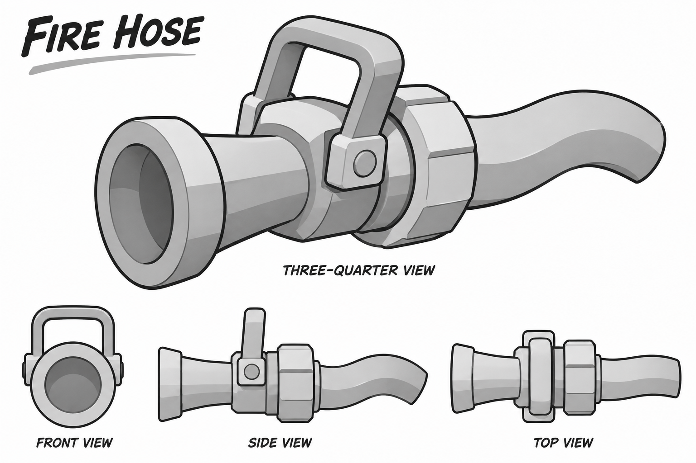
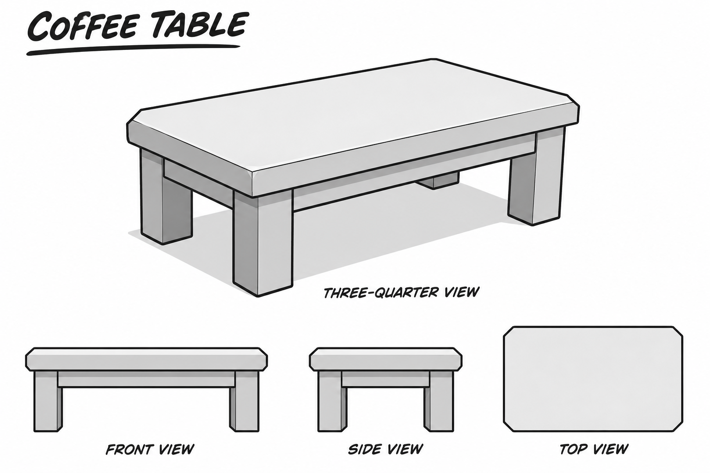
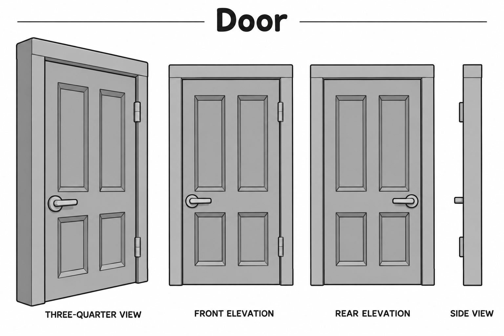

# Modeling Sketches

Status: Draft for review. Updated: 2026-11-16.

Nine grayscale concept sheets for modeling, generated with the built-in image_gen tool. They establish silhouettes and broad construction, not dimensionally exact CAD views, final textures or verified gameplay clearances. Final scale and collision geometry follow the playable blockout.

Sources: [Obsidian reference canvas](../../FireSlop/FireSlop/Consepts.canvas), [authoritative GDD](../../FireSlop/Documentation/GDD/GDD.md), [art guidelines](ART_DIRECTION_GUIDELINES.md). The supplied screenshots are visual references, not production textures. Sledgehammer and drone are new proposals in the same visual family.

## Sheets

### Resident

Oversized eyes and head, hoodie and short limbs. Use the aligned views for a neutral rigging pose; the large view supplies expression.

[Image](Characters/Resident/modeling-sheet.png) · [Generation prompt](Characters/Resident/prompt.json)

### Sledgehammer

Separate the head, shaft and grip. Keep the symmetrical blunt head and simple bevels.

[Image](Props/Sledgehammer/modeling-sheet.png) · [Generation prompt](Props/Sledgehammer/prompt.json)

### Fire Hose

Separate nozzle, bail handle, coupling and short hose. The hose continues beyond the illustrated section; this is not a closed solid tail.

[Image](Props/Hose/modeling-sheet.png) · [Generation prompt](Props/Hose/prompt.json)

### Sofa

Three seat and three back cushions, broad arms and short feet. Match the armchair family.

[Image](Props/Sofa/modeling-sheet.png) · [Generation prompt](Props/Sofa/prompt.json)

### Armchair

One seat and one back cushion. Match sofa bevels, upholstery and feet.

[Image](Props/Armchair/modeling-sheet.png) · [Generation prompt](Props/Armchair/prompt.json)

### Coffee Table

Plain low tabletop and four legs; keep its surface free of decorative props.

[Image](Props/CoffeeTable/modeling-sheet.png) · [Generation prompt](Props/CoffeeTable/prompt.json)

### Breakable Door

Intact four-panel door and separate frame. This sheet defines the apartment door; damage meshes are not included.

[Image](Props/Door/modeling-sheet.png) · [Generation prompt](Props/Door/prompt.json)

### Rescue Drone

Four guarded rotors, landing skids and open standing platform with restraint. Fit the actual firefighter and carried resident under the hull before finalizing size; the pale scale figure is illustrative, not a clearance proof.

[Image](Vehicles/RescueDrone/modeling-sheet.png) · [Generation prompt](Vehicles/RescueDrone/prompt.json)

### Base House

Three storeys, flat accessible roof and stair-access enclosure. This is an exterior concept, not an interior floor plan. Resolve the ground-floor side-window mismatch in blockout: use the side elevation for that opening. The second-floor rescue opening and rooftop landing clearance still require gameplay blockout validation. The double entrance door is a separate facade variant from the single apartment-door sheet.

[Image](Environments/BaseHouse/modeling-sheet.png) · [Generation prompt](Environments/BaseHouse/prompt.json)

## Review notes

All nine images were visually inspected for subject, view coverage and readable construction. Furniture cushion counts and four drone rotors are consistent. Minor perspective differences remain in drawn turnarounds; use orthographic views as construction guidance. No Unity assets, models, builds or runtime validation were created.

The reference canvas keeps its original nodes. A separate draft group presents these sheets through a vault symlink to the single maintained art directory.
